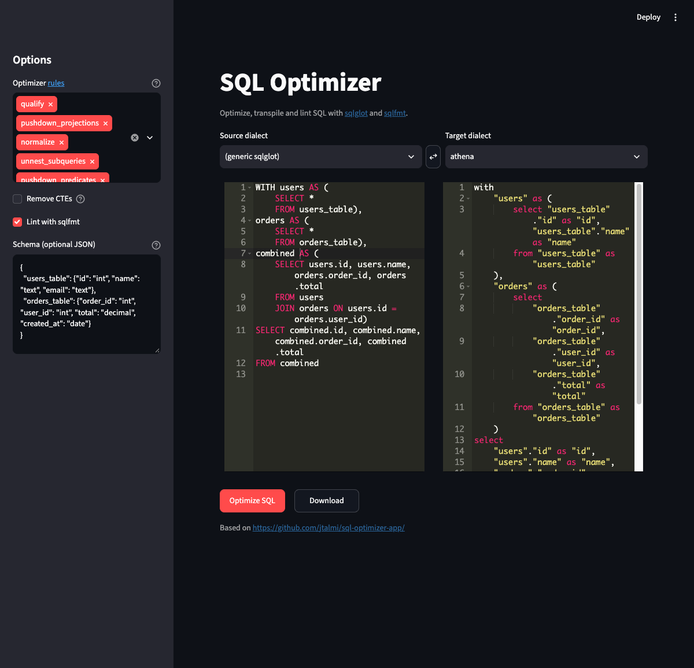

# SQL Optimizer Streamlit App
[](https://sql-optimizer.streamlit.app)

A web app to optimize, transpile and lint SQL queries using [sqlglot](https://github.com/tobymao/sqlglot) and [sqlfmt](https://sqlfmt.com).



## Features
- Optimize SQL with any combination of sqlglot's optimizer rules
- Transpile between all sqlglot dialects: the official ones, the
  [community dialects](https://github.com/tobymao/sqlglot#dialects) (marked "community"),
  and any third-party dialect installed as a `sqlglot.dialects` plugin
- Optional table schema (JSON) so `SELECT *` can be expanded and unused columns pruned
- Optionally merge CTEs into the main query
- Lint the result with sqlfmt
- Swap source/target dialects and download the result

## Build & Run
Requires [uv](https://docs.astral.sh/uv/) (Python 3.11+ is installed automatically).

```sh
uv sync
uv run sql-optimizer        # or ./run.sh
```

Extra arguments go to `streamlit run`, e.g. `uv run sql-optimizer --server.port 8080`.
The app listens on `localhost` only; pass `--server.address 0.0.0.0` to expose it on your network.

| Environment variable | Default   | Description              |
|----------------------|-----------|--------------------------|
| `EDITOR_HEIGHT`      | `500`     | Editor height in pixels  |
| `FONT_SIZE`          | `14`      | Editor font size         |
| `EDITOR_THEME`       | `monokai` | Ace editor theme         |

## Development
```sh
uv run pytest
uv run ruff check . && uv run ruff format .
uv export --format requirements-txt --no-emit-project > /tmp/req.txt \
  && uvx pip-audit -r /tmp/req.txt --disable-pip --require-hashes   # vulnerability scan
```

CI runs lint, tests and the vulnerability scan; Dependabot proposes weekly dependency and
GitHub Actions updates (with a 7-day cooldown).

## Usage
1. Pick the source and target dialects.
2. Enter your SQL query in the left editor.
3. In the sidebar, select the optimizer rules (clear them all to only transpile), and
   optionally provide a schema, remove CTEs or lint with sqlfmt.
4. Click **Optimize SQL**. The result appears in the right editor.

## Example
For the sample query and schema loaded by default:
```sql
WITH users AS (
    SELECT *
    FROM users_table),
orders AS (
    SELECT *
    FROM orders_table),
combined AS (
    SELECT users.id, users.name, orders.order_id, orders.total
    FROM users
    JOIN orders ON users.id = orders.user_id)
SELECT combined.id, combined.name, combined.order_id, combined.total
FROM combined
```
Applying all rules except `quote_identifiers` expands the `SELECT *` in the CTEs to only the
columns that are used, which has been shown to improve performance on
[some data warehouses](https://select.dev/posts/should-you-use-ctes-in-snowflake):
```sql
WITH users AS (
  SELECT
    users_table.id AS id,
    users_table.name AS name
  FROM users_table AS users_table
), orders AS (
  SELECT
    orders_table.order_id AS order_id,
    orders_table.user_id AS user_id,
    orders_table.total AS total
  FROM orders_table AS orders_table
)
SELECT
  users.id AS id,
  users.name AS name,
  orders.order_id AS order_id,
  orders.total AS total
FROM users AS users
JOIN orders AS orders
  ON orders.user_id = users.id
```
Without a schema, sqlglot can't expand `SELECT *`. In that case either provide one or drop the
`pushdown_projections` rule.
